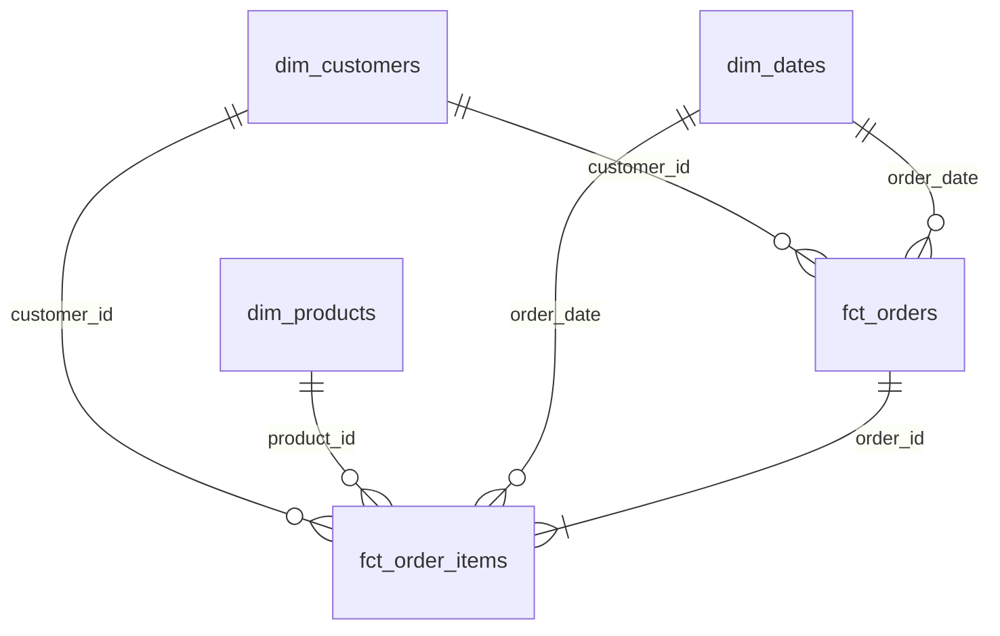
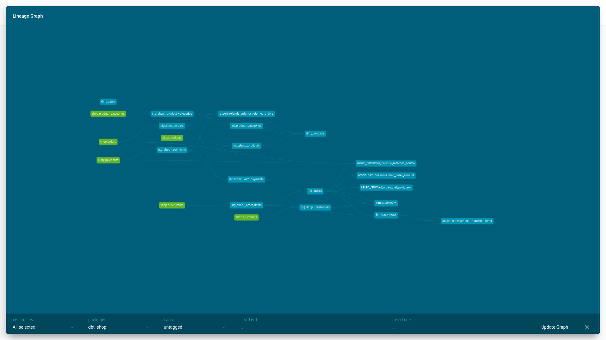

# store_hse

## Модель данных

ER диаграмма

Витрины

- fct_orders: одна строка - заказ. Вопрос: выручка по месяцам и средний чек по городам
- fct_order_items: одна строка - товар в заказе. Вопрос: выручка по категориям и какие бренды чаще возвращают
- dim_customers: одна строка - клиент, включая не купивших. Вопрос: доля покупателей по каналам привлечения.
- dim_products: одна строка - товар. Вопрос: структура категорий товаров
- dim_dates: одна строка - день. Вопрос: динамика продаж по дням недели и выходным

Хранение в greenplum

- fct_orders: distributed_by='order_id'. Большой факт, распределяется по ключу соединения
- fct_order_items: distributed_by='order_id'. Большой факт, распределяется по ключу
- dim_products: distributed_by='product_id'. Больше похож на большой факт
- dim_customers: distributed_replicated=true. Небольшой справочник
- dim_dates: distributed_replicated=true. Небольшой справочник

Граф lineage

